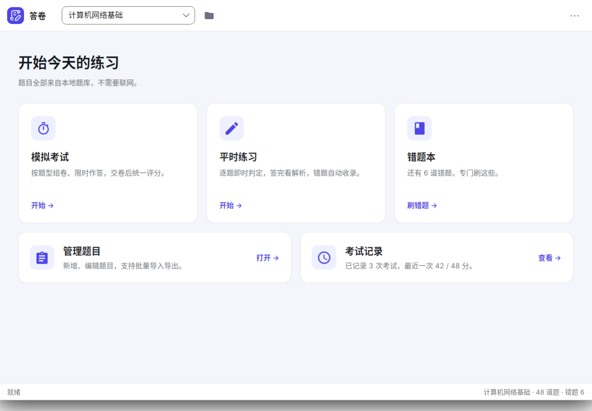

# AvaSheet（答卷）

本地的题库与考试练习工具，基于 Avalonia 12 与 .NET 10，界面用 Fluent 主题。



## 功能

- **管理题目**：增删改题目，支持从 JSON 与 Excel（`.xlsx` / `.xls` / `.xlsb`）批量导入，导入前自动判重。
- **平时练习**：按题型分组练习，选完立即判定并显示解析，进度自动记住，做错的题收进错题本。
- **错题本**：只刷做错的题，答对后自动移出。
- **模拟考试**：按题型组卷，限时作答，交卷后弹成绩小窗，关掉后回到冻结的卷面逐题回顾。
- **考试记录**：历次成绩落盘，可展开看当时的逐题作答（题目内容是快照，题库改动后仍可回看）。
- 跟随系统的深浅主题、可切换的硬件加速开关。

所有数据都存在用户目录下，不需要联网：

- Windows：`%AppData%\AvaSheet`
- Linux：`~/.config/AvaSheet`

## 目录结构

```
AvaSheet.slnx              解决方案
src/AvaSheet/              主程序
  Models/                    数据模型
  Services/                  存储、导入导出、渲染与主题等基础设施
  ViewModels/                页面与列表项的视图模型
  Views/                     窗口与页面
  Styles/                    颜色令牌、控件主题与页面样式
tests/AvaSheet.Tests/      xunit 测试
tools/make-icon/           应用图标生成脚本
docs/                      截图等文档用图
```

## 开发

需要 .NET 10 SDK。

```bash
dotnet build                        # 构建整个解决方案
dotnet test                         # 跑全部测试
dotnet run --project src/AvaSheet         # 启动程序
dotnet publish src/AvaSheet -c Release -r linux-x64 -p:PublishAot=true   # Native AOT 发布
```

不带 `-p:PublishAot=true` 时是普通的框架依赖发布，目标机器需要装 .NET 运行时。

`App.axaml` 等资源以 `src/AvaSheet` 为根，测试项目通过 `ProjectReference` 引用主项目。

## 启动参数

| 参数 | 作用 |
|---|---|
| `--gpu` | 本次启动强制使用硬件加速（不改设置文件） |
| `--software` | 本次启动强制使用软件渲染（不改设置文件） |
| `--render-diag` | 启动后打印实际使用的渲染后端 |
| `--font-diag` | 启动后打印中文回退字体的命中情况 |

默认使用软件渲染：有的显卡能初始化硬件加速，但运行一段时间后卡死，这种情况 Avalonia 无法自动回退。需要时可以在顶栏 `⋯` 菜单里打开硬件加速，重启后生效。
